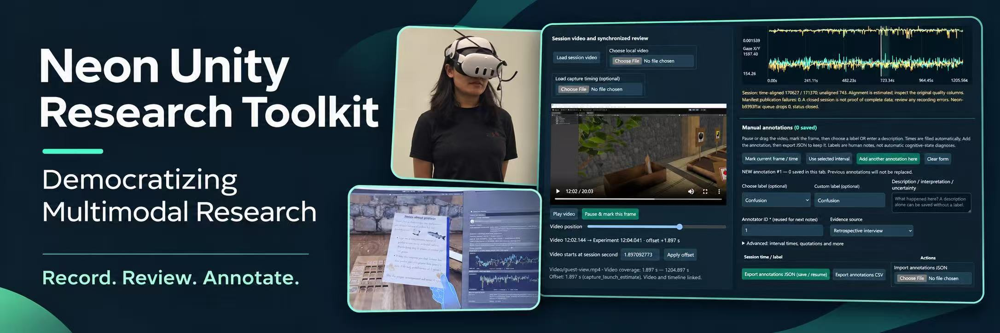
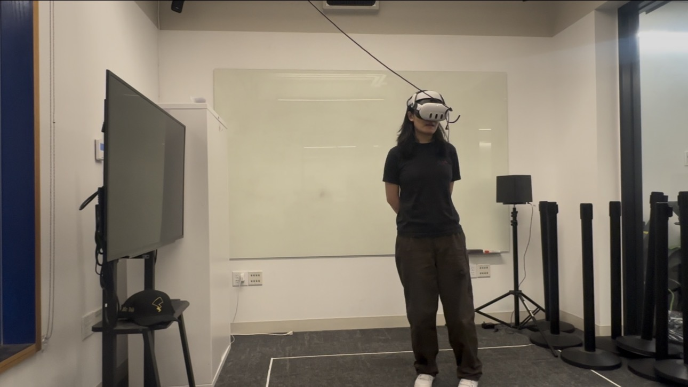
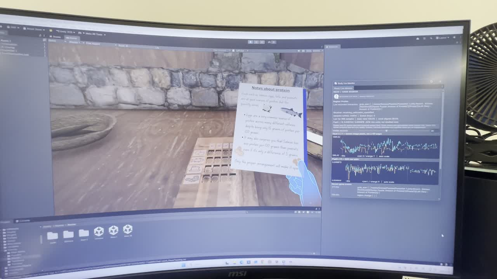
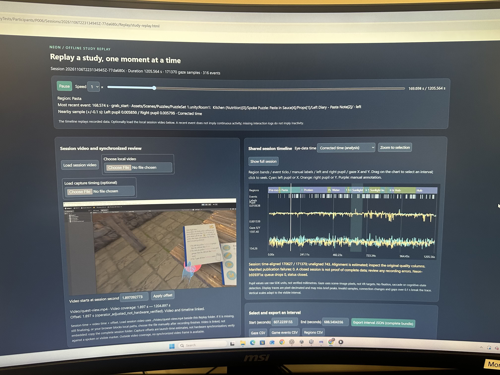
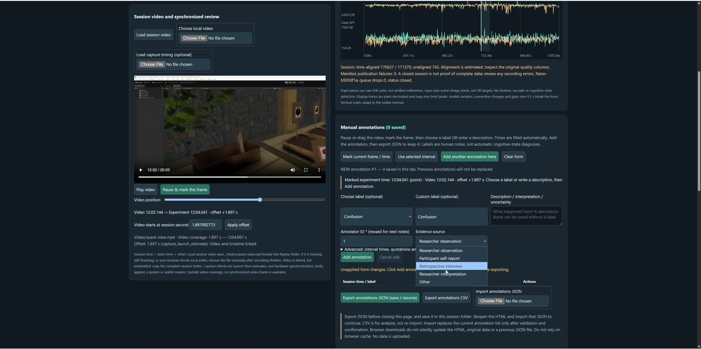

# Neon Unity Research Toolkit

**Bring Neon eye tracking into Unity VR studies—and return to the experience through offline video review and human annotation.**

An unofficial Unity research plugin for researchers in psychology, neuroscience and XR/HCI. It brings participant/session archives, available Neon eye data, head pose, explicitly connected interaction events and optional video/audio into a local research workflow.

The goal is to make multimodal VR research more accessible: configure recording in the Unity Editor, connect your experiment's events, and review sessions in a standalone HTML interface without reopening Unity.

**Status:** `0.1.0-preview.4` · Public preview for pilot use

**Current source / submission candidate:** `0.1.0-preview.5` — Publisher and copyright name: **Binyan Michelle xu**. This metadata update leaves runtime code unchanged; the signed preview.4 archive below is historical and still carries its original author metadata. See the [Publisher identity checklist](docs/publisher-identity.md) before store submission.

This preview fixes save/reopen serialization for Head Pose Source, Study Region and Interaction Adapter. See the changelog before upgrading; existing Missing Script references need manual re-attachment and field/callback restoration. Download the tested signed archive from the [preview.4 release](https://github.com/DolbyWu/neon-unity-research-toolkit/releases/tag/v0.1.0-preview.4).

**Current development/test environment:** Windows, Unity `6000.3.23f1`

**Hardware scope:** Pupil Labs Neon; other Pupil Labs devices are not currently claimed as supported.

> Independent installation and real Neon + Quest 3 tests passed core acquisition, head/interaction logging, media finalization and offline video review. See the [test results](docs/hardware-acceptance-2026-11-07.md) and [Validation](VALIDATION.md).

## Demo: HTML review and annotation

### ▶ Watch the introduction on YouTube

[](https://youtu.be/LUCue3x0qvk)

[](https://youtu.be/LUCue3x0qvk)

*Click the preview image or the red play button to watch on YouTube.*

The HTML workflow supports reviewing a recorded VR experience alongside eye and behavioral timelines, marking a video moment or selected interval, and adding human labels, descriptions and evidence sources.

- Pause or scrub local video and inspect the corresponding experiment time.
- Explore eye-data traces, configured regions and logged events.
- Add multiple point or interval annotations, with explicit editing.
- Distinguish researcher observation, participant self-report and retrospective interview evidence.
- Export annotation JSON to save/resume work, or CSV for analysis.

### VR study setup



A physical VR test setup from the author's original study.

### Unity experiment and live eye-data monitor · 16 seconds

[](https://github.com/DolbyWu/neon-unity-research-toolkit/blob/main/docs/media/vr-test.mp4)

[Watch the VR test and live monitor video](https://github.com/DolbyWu/neon-unity-research-toolkit/blob/main/docs/media/vr-test.mp4). The recording shows the running Unity experiment alongside eye-data traces and logged interactions.

### HTML replay and time-aligned data review



The standalone HTML review brings the recorded video, gaze/pupil traces, regions and behavioral events into one interface.

### Video-linked reflection and manual annotation · 1 minute 49 seconds

[](https://github.com/DolbyWu/neon-unity-research-toolkit/blob/main/docs/media/html-review-annotation.mp4)

[Watch the full HTML review and annotation walkthrough](https://github.com/DolbyWu/neon-unity-research-toolkit/blob/main/docs/media/html-review-annotation.mp4): navigate the video, mark an experiment time, choose a label, record an interpretation/evidence source, and retain multiple annotations.

These demonstrations show the author's original study workflow; UI and displayed units may differ from the extracted preview package. They illustrate working acquisition/review interactions, not independently measured synchronization accuracy. Pupil values displayed in the original study use its original SDK representation and must not be interpreted as validated millimetres. Videos are compressed MP4 copies of the supplied recordings; click a preview to open the video on GitHub, or download it if inline playback is unavailable.

## What the plugin provides

| Module | Current capability |
|---|---|
| Participant archive | Anonymous IDs, optional background details and per-session profile snapshots |
| Neon acquisition | Available gaze/pupil fields, native and receive timestamps, alignment/quality flags and raw payloads |
| Head pose | Unity head/camera world position and quaternion rotation |
| Behavioral logging | Explicit grab/release, task outcomes, custom events and observer markers |
| Regions | Head-location intervals in configured collider regions |
| Optional media | Local video and continuous microphone capture through separately installed tools |
| Offline review | HTML video review, eye/event timelines, interval extraction and manual annotations |
| Export | CSV, session metadata and annotation JSON/CSV |

**Head pose is not raw IMU recording.** Accelerometer and gyroscope streams are not currently provided by the head-pose logger.

The plugin does not automatically detect all interactions, map Neon image gaze to Unity objects, identify fixations/saccades or infer cognitive states. Labels are human interpretations with recorded evidence sources.

## Installation

### Recommended: tested signed archive

Download `com.dolbywu.neon-research-0.1.0-preview.4.tgz` and `SHA256SUMS.txt` from the [GitHub release](https://github.com/DolbyWu/neon-unity-research-toolkit/releases/tag/v0.1.0-preview.4). Keep the archive unchanged. In Unity Package Manager choose **Install/Add package from tarball** and select it. No Git installation is required. See the [release notes](RELEASE_NOTES.md) for tested scope and known issues. The signed package's embedded documentation preserves its pre-publication candidate wording; the release notes provide the subsequent test/publication record.

### Option A: install from disk

1. Download and extract this repository using **Code → Download ZIP**.
2. Open your Unity project with the supported Editor version.
3. In **Window → Package Manager**, choose **Install/Add package from disk**.
4. Select this file inside the extracted repository:

   ```text
   Packages/com.dolbywu.neon-research/package.json
   ```

Unity resolves `com.unity.nuget.newtonsoft-json` through Package Manager. Keep the extracted package folder in a stable location. Installation does not start acquisition.

### Option B: install from Git

With Git installed, use **Install/Add package from Git URL**:

```text
https://github.com/DolbyWu/neon-unity-research-toolkit.git?path=/Packages/com.dolbywu.neon-research#v0.1.0-preview.4
```

This pins the preview.4 source tag. The signed tarball is the installation route exercised in the real-device trials; the preview.4 tagged Git route has not had a separate post-publication acceptance run. Validate the route and exact version you use in your own study; see [Validation](VALIDATION.md).

### Try the included verification project

Open `VerificationProject` through Unity Hub using `6000.3.23f1`. It loads the sibling package and provides a minimal verification host, not a completed VR experiment. No headset, Neon, Python or FFmpeg is needed for a first data-only check.

## First recording: no eye device required

1. Open **Tools → Neon Research → Setup and Recording Settings**.
2. Choose a dedicated output folder. Enable **Record on Unity Play (opt-in)**; leave Neon and media disabled for this first check.
3. Click **Save project settings**.
4. Use a tagged Main Camera, or configure a **Head Pose Source** for your actual XR head Transform.
5. Open **Tools → Neon Research → Open Live Monitor** and press Play.
6. Confirm a new anonymous participant. Run for approximately 60 seconds and click **Mark observation**.
7. Stop Play normally. Inspect the new session folder and generated HTML replay.

Expected results: a participant/session folder, event rows, head pose when a source is available, a closed export manifest and a working offline report. No eye samples are expected with Neon disabled.

For detailed setup and troubleshooting, follow the [Quick Start](QUICKSTART.md).

## Connect Neon and your experiment

After the first recording works:

1. Prepare your Neon/Companion setup and network connection.
2. Enable **Receive Neon gaze** and enter the current Companion IPv4, API port and WebSocket port in recording settings.
3. Run a short session. Verify recent samples, quality, alignment status and actual pupil availability; a connection message alone is insufficient.
4. Configure your XR head Transform and region colliders/IDs.
5. Connect your interaction framework's actual UnityEvents to the interaction adapter, or use the explicit event API for custom tasks.

For example, from your own experiment code:

```csharp
using NeonResearch;

// Records only during an active recording session.
StudyEvents.Record(
    kind: "task_complete",
    objectId: "door_01",
    outcome: "success",
    detail: "Participant opened the exit",
    task: "escape_room"
);
```

No Meta or XRI SDK is bundled. Your host project remains responsible for its XR setup and actual interaction callbacks. See the [integration guide](Packages/com.dolbywu.neon-research/Documentation~/workflow.md).

## Manual annotations: review and reflect

Open the generated `Replay/study-replay.html` in Edge or Chrome. The offline report can be reviewed without Unity or the optional archive server.

1. Load the matching session video, when available.
2. Check the displayed video offset and timing method.
3. Pause or scrub to a moment and click **Pause & mark this frame**, or select a time interval.
4. Choose a label or enter a description, add the annotator ID and evidence source, and click **Add annotation**.
5. Use **Add another annotation here** to retain earlier annotations while creating another record.
6. **Export annotations JSON before closing.** Import that JSON to resume later. CSV is for analysis, not restoration.

This workflow supports researcher reflection and participant retrospective reports. Their evidence sources should remain distinguishable. Changing a label does not establish a psychological or neural state.

HTML, media and annotation JSON are separate local files. Copy the entire session folder when moving a study. Browser downloads do not silently save changes back into the HTML.

## Optional video, audio and archive tools

Data-only recording and HTML review do not require Python or FFmpeg.

Optional archive/capture helpers require operator-installed Python and, for media capture, FFmpeg with FFprobe. The current capture route is Windows-specific and includes a Quest/Oculus Mirror workflow. Capture is explicitly enabled and confirmed for each session.

Configure these only after basic data recording works. Verify the selected window, microphone, media coverage and finalized output before a participant study. See the [Quick Start](QUICKSTART.md).

## Timing and research readiness

- Unity events/head pose use a local monotonic session timeline.
- Neon alignment uses RTCP timestamps and Time Echo estimates; native, receive and aligned times remain distinguishable.
- Video offsets are based on capture launch estimates or operator adjustment, not verified first-frame hardware synchronization.
- Unavailable eye fields and unsupported data are identified; missing data must not be interpreted as valid zero measurements.

Run a short device trial and a complete task-length trial for your own setup. Check event coverage, sampling gaps, pupil availability, alignment, video/audio coverage, shutdown and export. The original VR study deployment does not by itself validate every installation or device/software combination.

Windows Unity Editor is the current development target. Standalone/Quest Android builds, other operating systems and other Unity versions remain unverified. See [Validation](VALIDATION.md).

## Data and privacy

Acquisition is off by default. Machine-local settings are stored under `UserSettings/NeonResearch`; the default output root is `NeonResearchData` in the host project.

Use anonymous IDs, obtain appropriate consent and keep identity mappings separately. Participant notes and recordings may still contain identifying information. Keep archives, settings and recordings out of Git. No automatic cloud upload or speech transcription is included.

## Documentation

- [Preview.4 test results](docs/hardware-acceptance-2026-11-07.md)
- [Release notes and installation](RELEASE_NOTES.md)
- [Quick Start](QUICKSTART.md)
- [Neon hardware connection and recording notes](docs/neon-hardware-setup.md)
- [Preview.3 acceptance checklist and next steps](docs/preview-3-acceptance.md)
- [Integration and review workflow](Packages/com.dolbywu.neon-research/Documentation~/workflow.md)
- [Validation and known limitations](VALIDATION.md)
- [Changelog](Packages/com.dolbywu.neon-research/CHANGELOG.md)
- [License](Packages/com.dolbywu.neon-research/LICENSE.md)
- [Third-party notices](<Packages/com.dolbywu.neon-research/Third Party Notices.md>)

## Roadmap

Future work may add a complete importable XR example scene, additional hardware providers, raw IMU sources, calibrated gaze-to-object mapping and improved video timing.

These are planned capabilities, not current support claims.

## Project status and license

This is an independent, unofficial project, not affiliated with or endorsed by Pupil Labs or Unity.

See the [MIT License](LICENSE) for the plugin's software licensing terms.

Third-party components retain their respective licenses; see the [dependency notices](<Packages/com.dolbywu.neon-research/Third Party Notices.md>). The MIT grant does not relicense third-party code, SDKs, game assets or other contributors' independently owned material.

**Demonstration photos, videos and research data are excluded from the code's MIT license.** Public display does not grant permission to reuse, redistribute or extract these materials. See [media permissions](docs/media/README.md); request separate permission from the relevant rights holders.

This licensing update does not change the development-preview status or imply vendor endorsement or validated research accuracy.
