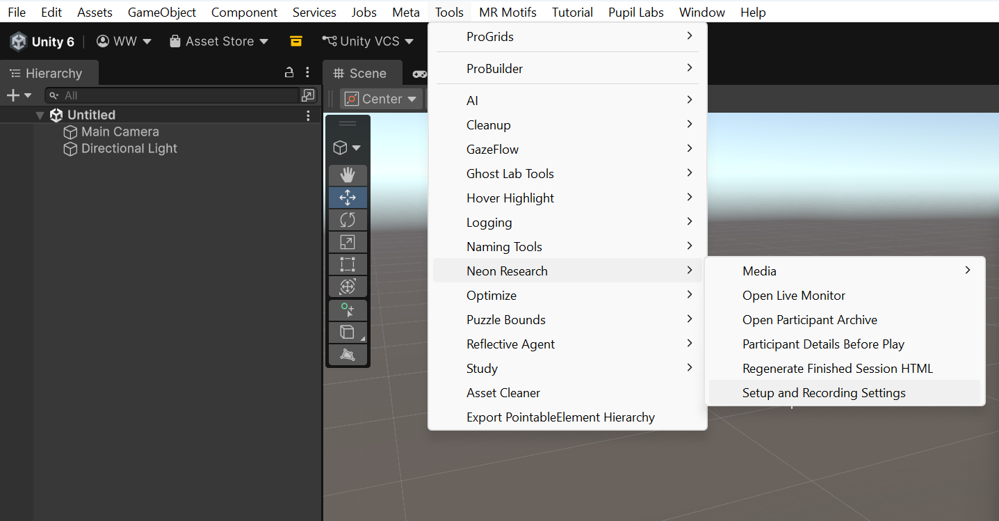
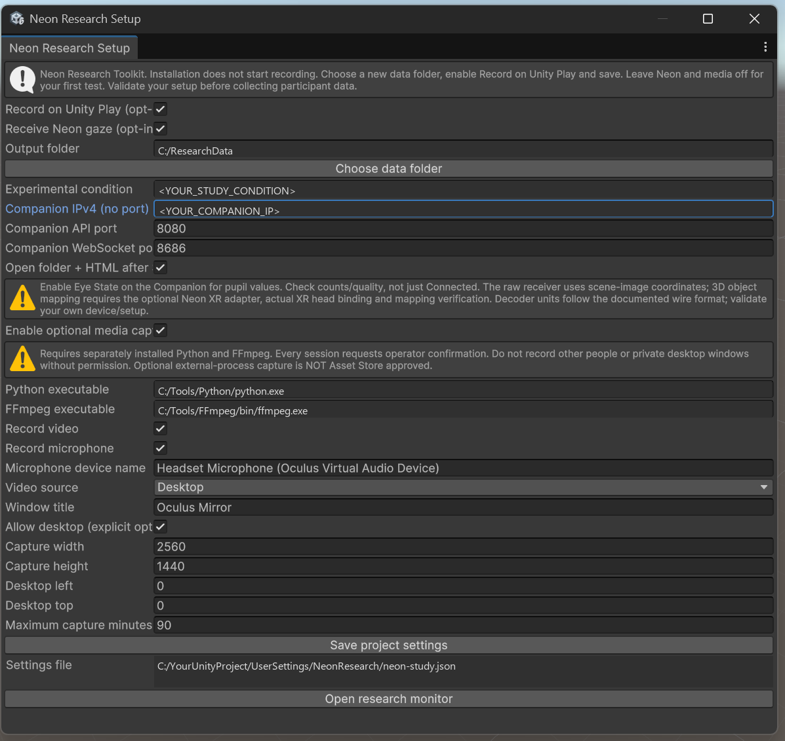
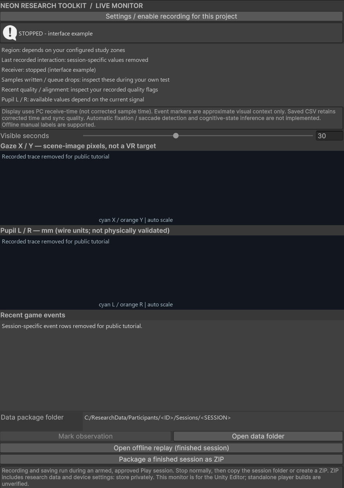
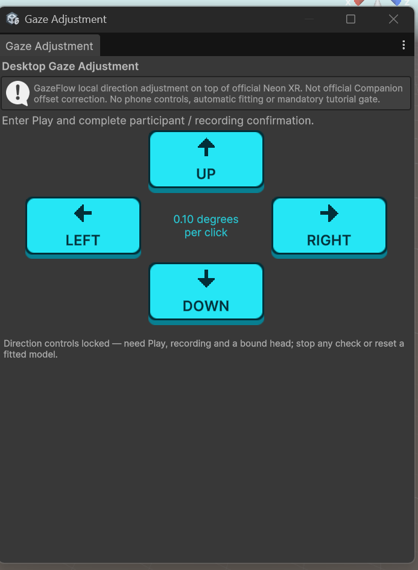
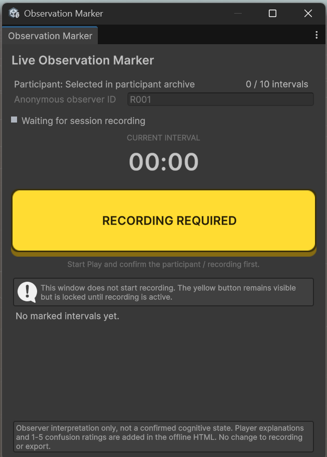

# Illustrated quickstart: recording, gaze adjustment and observation

**GazeFlow beta candidate · updated 2026-11-15 · Windows Unity Editor.** Screenshots show research-pipeline controls retained in the beta; the beta also adds **Tools > GazeFlow > Start Here** and **Neon XR Setup**. This is not an Asset Store edition. Start in an independent copy with the [current installation instructions](../QUICKSTART.md). Your project supplies its XR rig, scenes and task. See [generic XR setup](universal-neon-xr-setup.md) for references on arbitrary authored objects.

**Screenshot privacy:** local addresses/paths use placeholders, and recorded eye traces, counts and event rows have been removed from the public monitor image. The images illustrate interface locations only; they are not sample research data or evidence of accuracy. Extra Unity menu entries depend on the host project.

## 1. Open the recording settings

In Unity, choose **Tools > Neon Research > Setup and Recording Settings**.

Other useful entries in the same menu are **Open Live Monitor**, **Open Participant Archive**, and **Regenerate Finished Session HTML**. Use the [current Tools menu guide](tools-menu-guide.md) if an older screenshot or guide uses another path.

## 2. Configure your own connection and output folder

1. Choose a private **Output folder outside your Git repository**, such as `C:/ResearchData`. Set your study's condition code if needed.
2. Enter the phone's **current Companion IPv4**, without a port in that field. Confirm the API and WebSocket ports separately from your current configuration. Do not copy a previous session's network address. PC and phone need a network that permits device-to-device traffic; internet access alone is insufficient.
3. Explicitly enable **Record on Unity Play** and **Receive Neon gaze** when ready. Installation alone does not enable or start recording. The checked boxes in this screenshot illustrate a configured project, not installation defaults.
4. For optional local media, select your installed **Python** and **FFmpeg**, enable the required channels and choose the microphone Windows actually receives. Microphone capture does not imply game/system audio capture.
5. For a whole monitor, choose **Desktop**, explicitly allow desktop capture, and enter the actual monitor rectangle. The illustrated `2560 × 1440` is an example, not automatic monitor detection. Close private windows and obtain recording consent. The Window title field is not used for Desktop capture; a Mirror window is not required.
6. Click **Save project settings**. This saves configuration; it does not start recording.

For available pupil/eye-state values, enable the required Eye State stream in Companion. Raw acquisition and the optional official Neon XR spatial adapter have different roles. Three-dimensional object/AOI rays need the [spatial setup and real head binding](../Packages/com.dolbywu.neon-research/Documentation~/neon-xr-targets.md); simply entering an IP does not configure them.

## 3. Start a short session and check the monitor

Use **Tools > Neon Research > Open Participant Archive** to create/select an anonymous participant. Press **Play** and complete the configured participant/recording confirmation flow. The exact host entry screen depends on your project. Cancel confirmation if the participant or output location is wrong.

Open **Tools > Neon Research > Open Live Monitor**.

The screenshot is a **stopped interface example**, not a live test. Its empty graph areas are deliberate privacy redactions, not a demonstration of a working or failed stream.

During your own short test, check:

- Recent samples arrive and **Samples written** increases; inspect queue drops, invalid samples and gaps rather than trusting a connection label alone.
- **Gaze X/Y** is the original scene-image pixel stream, not the corrected 3D AOI ray or a fixation detector. **Pupil L/R** shows available wire values, not a device-specific physical validation.
- The participant sees the intended XR scene and tracked movement independently of whether counters increase.
- **Recent game events** contains the interactions you explicitly wired. Missing events do not prove inactivity; an Unknown region can mean your study has not configured region zones.

Do a brief spoken/movement test and inspect actual exported media before collecting a full session. Never treat the redacted screenshot as a data-quality target.

## 4. Optionally adjust the research gaze direction

Open **Tools > GazeFlow > Desktop Gaze Adjustment**. This is optional; an extra local correction or five-point check is not required to keep usable official rays and raw data recording.

**This screenshot is outside Play.** The bright cyan buttons are visible but locked. In an active recording with the correct tracked head bound, and with no running check or incompatible fitted model:

1. Use **Show gaze pointer**. Ask the wearer to look at a stable reference, not follow the cyan gaze point. A project-specific yellow reference may be available; it is not automatically supplied on every arbitrary object.
2. Choose a step and use the arrows to nudge the cyan **research ray**. Default step: **0.10°**. Right/left changes head-local horizontal angle; up/down changes vertical angle.
3. Click **Save gaze adjustment** and check the save confirmation. Then use **Hide gaze pointer** if desired. Save/Hide appear during the active workflow and are not visible in this idle screenshot.
4. If needed, use **Reset - use official ray without extra correction**. The optional independent accuracy check remains separate.

This is **not official Companion calibration** and does not change the phone's profiles. Saved manual angles describe what you applied, not residual error, fixation or verified attention. Raw Neon X/Y and pupil values remain unchanged. See the [detailed adjustment and offset-report guide](desktop-gaze-adjustment.md) for save receipts, head/session changes and limits.

## 5. Mark an observed episode during play

Open **Tools > GazeFlow > Live Observation Marker**. This is a researcher desktop panel, not a headset overlay.

**RECORDING REQUIRED is expected before recording.** The yellow control remains bright but cannot start a session. Start Play and complete participant/recording confirmation first.

During recording:

1. Enter an anonymous observer ID.
2. Click **START OBSERVATION** at the start of an episode.
3. Click **END OBSERVATION & WRITE NOTE** at its end. The interval ends immediately; note-writing time is not added.
4. In the note popup, enter your observation label and description, then save it. Keep directly observed behavior separate from interpretation.
5. Repeat up to **10 intervals in the session**. Finish/save notes before Stop. An interval still open at shutdown is marked interrupted.

The marker does not start capture, require approved gaze accuracy or infer cognitive state. During later review, record the player's explanation and optional **1–5 confusion rating** separately. The optional **1–10 intensity** field is a different measure. See [live observation instructions](live-observer-intervals.md).

## 6. Stop, replay and retain the files

Stop Play normally and wait for media finalization. If configured, the session folder and offline HTML open automatically. Otherwise use the monitor/archive or **Tools > Neon Research > Regenerate Finished Session HTML** for a finished session.

- Check the manifest, original CSV files, optional video/audio and session identity.
- In HTML, load the local video, inspect the shared timeline and review observation intervals with the player. Mark the current frame/time or a selected interval and add an interpretation with its evidence source.
- The left-column **Gaze offset report** shows recorded adjustments alongside the cursor. At time zero or a signal gap it can say **Not available**, even when a later save receipt is present. This is not evidence that the whole session failed.
- **Export annotations JSON** before closing; import it on reopening to continue. CSV is for analysis, not annotation restore. Offset JSON/CSV and interval-bundle exports remain available separately.
- Copy the complete session folder when transferring local video and HTML. Keep study recordings private; do not upload participant archives, credentials or local connection settings to GitHub.

These screenshots document the controls; perform your own short hardware, framing, sound, stream-loss and session-isolation checks before a real study.
